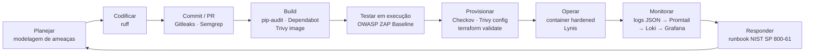
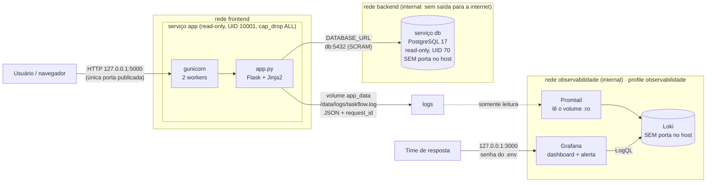

# TaskFlow — Esteira DevSecOps


A TaskFlow é um gerenciador de tarefas (to-do list) em Python/Flask, usado na
disciplina de DevSecOps. Partindo da versão **propositalmente vulnerável**
(o `app-exemplo/` do material da disciplina, que não está versionado aqui;
as saídas das ferramentas contra ele estão em
[`docs/evidencias/antes/`](docs/evidencias/antes/)), este repositório entrega a aplicação **corrigida** e
protegida por uma esteira de CI segura no GitHub Actions. Cada ferramenta é um
**gate**: se ela encontra um problema, o check fica vermelho e o merge na
`main` é bloqueado.

## Identificação

| | |
|---|---|
| **Instituição** | Cesar School |
| **Disciplina** | DevSecOps |
| **Professores** | Cris Apolinário<br>Diego Buarque de Amorim Batista |
| **Equipe** | Artur Torres Lima Cavalcanti<br>Eduardo Henrique Ferreira Fonseca Barbosa<br>Gabriel de Medeiros Almeida<br>Mauro Sérgio Rezende da Silva<br>Silvio Barros Tenório |

## Sumário

- [Ciclo de vida seguro (S-SDLC)](#ciclo-de-vida-seguro-s-sdlc)
- [Arquitetura](#arquitetura)
- [A esteira (workflows)](#a-esteira-workflows)
- [Como disparar cada workflow](#como-disparar-cada-workflow)
- [Proteção da branch main](#proteção-da-branch-main)
- [Como executar localmente](#como-executar-localmente)
- [Como executar com Docker (hardened)](#como-executar-com-docker-hardened)
- [Como executar com Docker Compose (app + PostgreSQL)](#como-executar-com-docker-compose-app--postgresql)
- [Infraestrutura como código (Terraform)](#infraestrutura-como-código-terraform)
- [Observabilidade e resposta a incidentes](#observabilidade-e-resposta-a-incidentes)
- [Vulnerabilidades corrigidas](#vulnerabilidades-corrigidas)
- [Decisões técnicas e trade-offs](#decisões-técnicas-e-trade-offs)
- [Estrutura do repositório](#estrutura-do-repositório)

## Ciclo de vida seguro (S-SDLC)

Em que fase do ciclo entra cada ferramenta da esteira:



## Arquitetura

Ambiente do `docker-compose.yml`:



- **Aplicação:** Flask servido pelo **gunicorn** (nunca pelo servidor de
  desenvolvimento). HTML apenas via templates Jinja2 com autoescape.
- **Banco:** **PostgreSQL** no Compose, isolado na rede `backend` (marcada
  `internal`) e sem porta publicada no host. Sem `DATABASE_URL`, o app usa
  **SQLite**: é assim no desenvolvimento local e no container do DAST no CI.
- **Containers:** app e banco com raiz somente leitura, usuário não-root,
  `cap_drop: ALL`, `no-new-privileges` e limites de CPU, memória e processos.
  Imagens fixadas por digest.
- **Rede:** a única porta publicada é a 5000 da app, e só no `localhost` do
  host (`127.0.0.1:5000`).
- **Observabilidade:** cada requisição gera um log JSON com `request_id` e
  `ip` (eventos `http_request`, `login_attempt`, `task_created`,
  `tasks_list_accessed`, `csrf_rejected`), sem senha, token ou cookie. O
  Promtail lê os logs, envia ao Loki e o Grafana consulta via LogQL. Detalhes
  em [Observabilidade e resposta a incidentes](#observabilidade-e-resposta-a-incidentes).

## A esteira (workflows)

Todos os workflows têm `permissions: contents: read` (menor privilégio). Todas
as actions são **pinadas por SHA de commit**, com a versão no comentário: uma
tag como `@v4` pode ser movida pelo dono da action para outro código, o SHA
não. O Dependabot atualiza SHA e comentário juntos.

| Workflow | Job (required check) | O que faz | Reprova quando |
|---|---|---|---|
| `ci-basico.yml` | `build-e-lint` | Instala as dependências com `--require-hashes` e roda `ruff check` + `ruff format --check` | Erro de lint ou de formatação |
| `sast.yml` | `SAST - Semgrep` | Semgrep com `p/python`, `p/flask` e `p/security-audit` (`--error`) | Qualquer achado no código |
| `sast.yml` | `Secret Scanning - Gitleaks` | Gitleaks no **histórico completo** (`fetch-depth: 0`), com o binário conferido por SHA-256 | Qualquer segredo em qualquer commit |
| `sca.yml` | `SCA - pip-audit` | `pip-audit --strict` no `requirements.txt` (inclui as dependências transitivas) | Qualquer CVE conhecida |
| `container.yml` | `trivy-image` | Builda o `Dockerfile` da raiz e roda `trivy image` | CVE HIGH/CRITICAL com correção disponível |
| `dast.yml` | `zap-baseline` | Builda a imagem, sobe a app **no próprio runner** com as flags seguras, espera o `/login` responder e roda o ZAP Baseline | Alerta não justificado em `.zap/rules.tsv` |
| `iac-scan.yml` | `checkov` | Checkov em Terraform, Dockerfile e nos próprios workflows | Qualquer falha |
| `iac-scan.yml` | `trivy-config` | Trivy config (sucessor do tfsec) | Má configuração HIGH/CRITICAL |
| `iac-scan.yml` | `terraform-validate` | `terraform init` (provider conferido pelo `.terraform.lock.hcl`), `fmt -check` e `validate` no `infra/` | Terraform inválido ou fora do padrão |

Além dos workflows, o **Dependabot** (`.github/dependabot.yml`) abre PRs
semanais para `pip`, `docker` (imagem base), `docker-compose` (Postgres),
`terraform` (provider AWS) e `github-actions`.

## Como disparar cada workflow

Todos os workflows disparam de três formas:

1. **Pull Request**, que é o gate: abrir ou atualizar um PR roda a esteira
   inteira.
2. **Push na `main`**, depois do merge: confirma o estado da `main`.
3. **Manualmente**, pela aba **Actions → (workflow) → Run workflow**, ou com o
   GitHub CLI:

```bash
gh workflow run ci-basico.yml
gh workflow run sast.yml
gh workflow run sca.yml
gh workflow run container.yml
gh workflow run dast.yml
gh workflow run iac-scan.yml

gh run list --limit 10          # acompanhar
gh pr checks --watch            # checks do PR atual
```

O relatório do ZAP fica como artefato da execução (`zap-baseline-report`).

## Proteção da branch main

- **Pull Request obrigatório.** Ninguém faz push direto na `main`, nem
  administradores.
- **Required status checks:** os 9 jobs da tabela acima, com a branch
  atualizada em relação à `main`.
- **CODEOWNERS** (`.github/CODEOWNERS`): todo PR precisa da aprovação de pelo
  menos 1 code owner. Aprovações antigas caem quando entra commit novo.
- Force push e exclusão da `main` bloqueados.

> Se um job for renomeado, o nome do required check precisa ser atualizado na
> proteção. Caso contrário, a `main` fica esperando um check que não existe
> mais.

## Como executar localmente

```bash
python3 -m venv .venv
source .venv/bin/activate          # Windows: .venv\Scripts\activate
pip install --require-hashes -r requirements.txt

# Segredos vêm do ambiente, nunca do código
export TASKFLOW_SECRET_KEY="$(openssl rand -hex 32)"
export TASKFLOW_ADMIN_PASSWORD="<escolha-uma-senha>"
export TASKFLOW_ALUNO_PASSWORD="<escolha-outra-senha>"
python app.py                      # servidor de desenvolvimento, só local
```

A aplicação sobe em `http://127.0.0.1:5000`. Na primeira execução, os
usuários `admin` e `aluno` são criados no SQLite com as senhas acima,
armazenadas **apenas como hash**. Um usuário cuja variável não estiver
definida não é criado. Sem `TASKFLOW_SECRET_KEY`, a aplicação não sobe.

| Variável | Uso | Padrão |
|---|---|---|
| `TASKFLOW_SECRET_KEY` | Chave de sessão do Flask (**obrigatória**) | — |
| `TASKFLOW_ADMIN_PASSWORD` / `TASKFLOW_ALUNO_PASSWORD` | Senhas iniciais | usuário não criado |
| `FLASK_DEBUG` | Debug do Flask, **só em desenvolvimento** | `false` |
| `FLASK_RUN_HOST` | Interface do servidor de desenvolvimento | `127.0.0.1` |
| `DATABASE_URL` | Se definida, usa PostgreSQL (o Compose define) | SQLite |
| `TASKFLOW_DATABASE` | Caminho do SQLite (sem `DATABASE_URL`) | `taskflow.db` |
| `TASKFLOW_LOG_DIR` | Diretório dos logs JSON | `logs` |
| `TASKFLOW_SECURE_COOKIE` | Cookie só via HTTPS | `false` |

Lint antes de abrir o PR:

```bash
pip install ruff==0.17.4
ruff check . && ruff format --check .
```

## Como executar com Docker (hardened)

```bash
docker build -t taskflow:local .
./scripts/docker-run-seguro.sh taskflow:local
```

O script gera os segredos na hora e sobe o container com as flags de runtime
seguras:

| Flag | Por quê |
|---|---|
| `--read-only` | Raiz somente leitura: um invasor não consegue alterar o código |
| `--tmpfs /data` e `--tmpfs /tmp` (`uid=10001`, `noexec`, `nosuid`) | Únicos lugares graváveis (banco, logs, heartbeat do gunicorn) |
| `--cap-drop=ALL` | Remove todas as capabilities do Linux |
| `--security-opt=no-new-privileges` | Impede escalada de privilégio (setuid) |
| `--memory=256m --cpus=0.5 --pids-limit=100` | Limita abuso de recursos (DoS) |
| `-p 127.0.0.1:5000:5000` | Porta acessível só pelo próprio host |

No fim, o script imprime as evidências: flags aplicadas, `uid=10001` e uma
tentativa de escrita recusada com `Read-only file system`.

## Como executar com Docker Compose (app + PostgreSQL)

```bash
cp .env.example .env
# valores aleatórios (hex, para não quebrar a DATABASE_URL)
sed -i "s/^TASKFLOW_SECRET_KEY=.*/TASKFLOW_SECRET_KEY=$(openssl rand -hex 32)/" .env
sed -i "s/^POSTGRES_PASSWORD=.*/POSTGRES_PASSWORD=$(openssl rand -hex 24)/" .env
sed -i "s/^TASKFLOW_ADMIN_PASSWORD=.*/TASKFLOW_ADMIN_PASSWORD=$(openssl rand -hex 12)/" .env
git check-ignore -v .env            # o .env real nunca é versionado

docker compose up -d --build
docker compose ps                   # app e db "healthy"; db sem porta publicada
```

| Requisito (PDF) | Onde está no `docker-compose.yml` |
|---|---|
| Redes frontend/backend isoladas | `networks`: a `backend` é `internal: true` e só app e db estão nela |
| Banco sem porta exposta ao host | serviço `db` **sem** `ports:` |
| Segredos via `.env` + `.env.example` | `${VAR:?mensagem}`: o Compose aborta se faltar uma variável |
| `read_only` | nos dois serviços (graváveis só volumes e `tmpfs`) |
| `healthcheck` | app (`/login`) e db (`pg_isready`); a app só sobe com o banco saudável |
| Limites de CPU e memória | `deploy.resources.limits` (e `pids`) |
| `no-new-privileges` | `security_opt` nos dois, junto com `cap_drop: ALL` |

Validado localmente:
- app e db ficam `healthy`;
- a porta 5432 fica fechada no host e o banco não tem saída para a internet;
- os dados persistem depois de `down`/`up`;
- a senha fica gravada como hash scrypt no Postgres;
- `admin' --` é recusado.

## Infraestrutura como código (Terraform)

`infra/` é a versão corrigida do `main.insecure.tf` do Módulo 5. Ela serve só
para validação: não há `terraform apply` no lab.

| Exigência | Implementação |
|---|---|
| Bucket privado | `public_access_block` com os 4 bloqueios `true` + ACLs desligadas (`BucketOwnerEnforced`) + política que nega acesso sem HTTPS |
| Criptografado | SSE-KMS com chave própria, rotação anual e bucket key |
| Versionado | `aws_s3_bucket_versioning` = `Enabled`, com expiração de versões antigas |
| Com logging | `aws_s3_bucket_logging` para um bucket de logs dedicado (também privado, criptografado e versionado, com retenção de 1 ano) |
| Security group restrito a uma variável de IP | Entrada (443 e 22) só de `var.ip_permitido`; saída só HTTPS para `var.cidr_saida`. As **duas variáveis recusam `0.0.0.0/0`** na validação |

```bash
cd infra
terraform init -backend=false && terraform fmt -check && terraform validate
checkov -d . --framework terraform     # 55 passed, 0 failed, 6 skips justificados
trivy config .                          # 0 achados
```

Os `#checkov:skip` e o `#trivy:ignore` ficam no próprio recurso, cada um com
a justificativa: replicação entre regiões fora do escopo (custo), notificações
de evento sem consumidor, security group sem instância no lab e o bucket de
logs que não pode registrar o acesso a si mesmo.

## Observabilidade e resposta a incidentes

```bash
# .env com GRAFANA_ADMIN_PASSWORD (ver .env.example)
docker compose --profile observabilidade up -d --build
# Grafana: http://127.0.0.1:3000  (usuário admin, senha do .env)
#   Dashboards → TaskFlow → "TaskFlow - Seguranca (logins e forca bruta)"
#   Alerting → Alert rules → "Forca bruta no login (> 10 falhas/IP em 5 min)"
```

Datasource, dashboard e regra de alerta são **provisionados a partir do
repositório** (`observabilidade/grafana/`) e não podem ser editados pela
interface: mudança só por PR.

**Logs:**
- A app grava JSON em `/data/logs/taskflow.log` (volume `app_data`).
- O Promtail monta esse volume **somente leitura** e transforma em label só
  `level` e `event`, que têm poucos valores distintos.
- `ip`, `username` e `request_id` são filtrados na consulta com `| json`.
- Toda resposta HTTP traz o cabeçalho **`X-Request-ID`**, para achar no Loki
  todos os eventos de uma requisição.

**Consultas LogQL** (todas no dashboard):

| # | Pergunta | LogQL |
|---|---|---|
| Q1 | **Quantas falhas de login por IP?** (detecção de força bruta: alerta e runbook) | `sum by (ip) (count_over_time({job="taskflow", event="login_attempt"} \| json \| result="failure" [5m]))` |
| Q2 | Como está a saúde da app (respostas por status HTTP)? | `sum by (status_code) (count_over_time({job="taskflow", event="http_request"} \| json [1m]))` |
| Q3 | O que aconteceu nesta requisição? | `{job="taskflow"} \| json \| request_id="<X-Request-ID>"` |
| Q4 | Quais usuários estão sendo mais atacados? | `topk(5, sum by (username) (count_over_time({job="taskflow", event="login_attempt"} \| json \| result="failure" [15m])))` |
| Q5 | O atacante conseguiu entrar? | `{job="taskflow", event="login_attempt"} \| json \| result="success" \| ip="<IP>"` |

**Simulação de força bruta.** O atacante roda num container separado, com IP
próprio, para não se confundir com o usuário legítimo:

```bash
docker run --rm --network taskflow_frontend -v "$PWD/scripts":/s:ro \
  curlimages/curl:8.17.0 sh /s/brute_force.sh http://app:5000 admin 50 0.2
```

Resultado do exercício de 12/11/2026:
- 50 tentativas em 15 s a partir de `172.22.0.4`, todas recusadas;
- o alerta disparou só para o IP atacante, 9 s depois da última tentativa;
- o usuário legítimo, com 2 erros de senha, ficou em *Normal*;
- nenhuma senha apareceu no Loki.

Evidências em [`docs/evidencias/observabilidade/`](docs/evidencias/observabilidade/)
e tratamento completo nas 4 fases do NIST SP 800-61 no
**[runbook de força bruta](docs/runbook-forca-bruta.md)**.

## Vulnerabilidades corrigidas

Classificação pelo **OWASP Top 10:2025**, a edição atual. Ela substituiu a de
2021, renumerou as categorias e criou A03 Software Supply Chain Failures e
A10 Mishandling of Exceptional Conditions.

| Vulnerabilidade (versão original) | Correção | OWASP Top 10:2025 |
|---|---|---|
| SQL Injection no login e na busca `q` | Consultas parametrizadas | A05 Injection |
| XSS armazenado e refletido (incluindo `q` e a mensagem de erro do login) | Templates Jinja2 com autoescape, sem `\| safe` | A05 Injection |
| `SECRET_KEY` hardcoded | Variável `TASKFLOW_SECRET_KEY`, sem fallback | A04 Cryptographic Failures |
| Senhas em texto puro | Hash (Werkzeug/scrypt), senhas iniciais vindas do ambiente | A04 Cryptographic Failures / A07 Authentication Failures |
| `/debug/info` expondo o ambiente e a chave | Rota removida | A02 Security Misconfiguration |
| `debug=True` fixo (debugger interativo e stack traces na resposta) | `FLASK_DEBUG`, desligado por padrão | A02 Security Misconfiguration / A10 Mishandling of Exceptional Conditions |
| Sem headers de segurança e sem CSRF | CSP sem `unsafe-inline`, `X-Frame-Options`, `nosniff`, `Referrer-Policy`, cookie `HttpOnly` + `SameSite`, token CSRF em todo POST | A02 Security Misconfiguration / A01 Broken Access Control (CSRF) |
| Dependências com CVEs | Versões atualizadas, `pip-audit` e Dependabot na esteira | A03 Software Supply Chain Failures |
| Dependências e imagem base sem verificação de integridade | `--require-hashes`, imagem base fixada por digest, actions pinadas por SHA | A08 Software or Data Integrity Failures / A03 Software Supply Chain Failures |
| Dockerfile inseguro (root, servidor de desenvolvimento, debug) | Usuário não-root, gunicorn, debug desligado, raiz somente leitura | A02 Security Misconfiguration |

Evidências reais do antes × depois (Semgrep, pip-audit, Trivy, `docker
history`, ZAP e testes manuais de SQLi e XSS) estão em
[`docs/evidencias/`](docs/evidencias/README.md).

O mapeamento completo, alerta por alerta do ZAP (ID, CWE, risco, antes e
depois) e achado por achado das outras ferramentas, com o risco residual de
cada categoria, está em [`docs/owasp-mapeamento.md`](docs/owasp-mapeamento.md).

### Demo de shift-left

Roteiro ensaiado em [`docs/demo-shift-left.md`](docs/demo-shift-left.md): um
PR que reintroduz `| safe` no template deixa o `SAST - Semgrep` vermelho, e um
que remove o header `nosniff` deixa o `zap-baseline` vermelho. O merge fica
bloqueado até o revert.

## Decisões técnicas e trade-offs

- **`iac-scan.yml` sem filtro `paths:`.** Com o filtro, o scan só rodaria
  quando um `.tf` mudasse. Como ele é required check, PRs que não mexem em
  infraestrutura ficariam travados esperando um check que nunca roda. O scan
  leva segundos, então roda em todo PR. O Checkov também olha o `Dockerfile`
  e os workflows, que também são infraestrutura como código.
- **`apt-get upgrade` no Dockerfile.** Mesmo a versão mais recente da
  `python:3.12-slim` saiu com 2 CVEs HIGH no `zlib1g` já corrigidas no Debian
  (CVE-2026-76844 e CVE-2026-85091, em 12/11/2026). Aplicar as atualizações
  de segurança no build zera os achados. O custo: o build deixa de ser 100%
  reprodutível, porque o resultado do upgrade depende do dia.
- **`ignore-unfixed` no Trivy image.** CVEs sem correção publicada não são
  acionáveis (não há versão para onde ir) e travariam todo PR. Elas continuam
  visíveis num `trivy image` sem filtro.
- **Dependências travadas com hash** (`requirements.in` → `pip-compile
  --generate-hashes` → `requirements.txt`). O Docker e o CI instalam com
  `--require-hashes`: um pacote adulterado no PyPI quebra o build em vez de
  entrar na imagem. O Dependabot entende esse formato e atualiza os dois
  arquivos.
- **`.zap/rules.tsv`.** Só alertas informativos ou que não se aplicam foram
  rebaixados para IGNORE, cada um com justificativa na própria linha. Qualquer
  outro alerta reprova o `zap-baseline` (`fail_action: true`, sem
  `continue-on-error`).
- **Gitleaks sem allowlist.** A linha de base foi commitada já sem os
  segredos didáticos, então o histórico não tem nada a suprimir. Nenhuma regra
  foi desligada.
- **PostgreSQL no Compose, SQLite no dev e no DAST.** O PDF pede um banco
  isolado, sem porta no host, e isso só faz sentido com um serviço de banco
  separado. Por isso o Compose usa Postgres. O `app.py` escolhe o banco pela
  `DATABASE_URL` com um adaptador mínimo, e as consultas continuam
  parametrizadas nos dois casos. O dev local e o DAST do CI seguem com SQLite,
  porque sobem a app sozinha no runner, sem depender de um banco externo.
- **Postgres sem root.** O serviço `db` roda direto como o usuário `postgres`
  (UID 70), com raiz somente leitura e `cap_drop: ALL`. A imagem oficial
  normalmente começa como root para fazer `chown`; rodando como o próprio
  usuário, ela não precisa de nenhuma capability.
- **Saída do security group restrita.** O modelo do curso liberava HTTPS de
  saída para `0.0.0.0/0`, e o Trivy acusa isso como CRITICAL (AWS-0104). Em vez
  de suprimir o alerta, a saída foi limitada a `var.cidr_saida` (proxy de
  saída ou VPC endpoints).
- **Promtail, mesmo descontinuado.** O PDF pede Grafana + Loki + Promtail. A
  Grafana encerrou o Promtail em 2026 em favor do Grafana Alloy, por isso foi
  usada a **última versão publicada (3.6.11)**, fixada por digest, rodando
  como não-root, somente leitura, sem capabilities e sem porta. Num projeto
  real, o próximo passo seria migrar para o Alloy.
- **Stack de observabilidade sem portas expostas.** Loki e Promtail ficam numa
  rede `internal`, e a única entrada é o Grafana em `127.0.0.1:3000`, com a
  senha do `.env`. Assim ninguém de fora lê nem injeta logs falsos no Loki.
- **Alerta por IP, não global.** Um limite global de falhas confundiria um
  usuário que erra a senha com um ataque. Agrupando por IP, o exercício
  separou os dois. A limitação conhecida é o ataque distribuído (muitos IPs),
  que está nas ações do pós-incidente do runbook.

## Estrutura do repositório

```
.
├── .github/
│   ├── CODEOWNERS              # aprovação obrigatória de 1 code owner
│   ├── dependabot.yml          # pip, docker, docker-compose, terraform, github-actions
│   └── workflows/              # ci-basico, sast, sca, container, dast, iac-scan
├── .zap/rules.tsv              # regras do ZAP com justificativa
├── app.py                      # aplicação Flask corrigida + logging JSON
├── templates/                  # login.html, tasks.html, new_task.html
├── requirements.in             # dependências diretas (editar aqui)
├── requirements.txt            # gerado pelo pip-compile, com hashes
├── pyproject.toml              # configuração do ruff
├── gunicorn.conf.py            # servidor WSGI de produção
├── Dockerfile                  # imagem hardened (FALHAS 1 a 6 corrigidas)
├── .dockerignore
├── docker-compose.yml          # app + PostgreSQL (+ profile observabilidade)
├── .env.example                # modelo do .env (o .env real não é versionado)
├── infra/                      # Terraform: S3 privado/KMS/versionado/logging + SG
│   ├── versions.tf  variables.tf  main.tf  outputs.tf
│   └── .terraform.lock.hcl     # hashes do provider (conferidos no CI)
├── observabilidade/            # Loki, Promtail e Grafana (datasource, dashboard, alerta)
├── scripts/
│   ├── docker-run-seguro.sh    # docker run com as flags seguras
│   └── brute_force.sh          # simulação de força bruta (só no lab)
└── docs/
    ├── runbook-forca-bruta.md  # NIST SP 800-61, exercitado com dados reais
    ├── owasp-mapeamento.md     # achados (ZAP e demais) -> OWASP Top 10:2025
    ├── demo-shift-left.md      # roteiro da demo do gate barrando o PR
    └── evidencias/             # antes × depois + observabilidade
```

> Nunca versione `.env`, `*.db` ou logs (já estão no `.gitignore`). Segredos
> do CI ficam em **Settings → Secrets and variables → Actions**.
