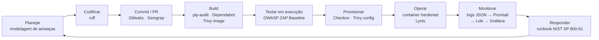
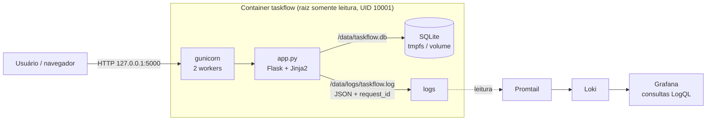

# TaskFlow — Esteira DevSecOps


A TaskFlow é um gerenciador de tarefas (to-do list) em Python/Flask, usado na
disciplina de DevSecOps. Partindo da versão **propositalmente vulnerável**
(`app-exemplo/`), este repositório entrega a aplicação **corrigida** e
protegida por uma esteira de CI segura no GitHub Actions. Cada ferramenta é um
**gate**: se ela encontra um problema, o check fica vermelho e o merge na
`main` é bloqueado.

## Sumário

- [Ciclo de vida seguro (S-SDLC)](#ciclo-de-vida-seguro-s-sdlc)
- [Arquitetura](#arquitetura)
- [A esteira (workflows)](#a-esteira-workflows)
- [Como disparar cada workflow](#como-disparar-cada-workflow)
- [Proteção da branch main](#proteção-da-branch-main)
- [Como executar localmente](#como-executar-localmente)
- [Como executar com Docker (hardened)](#como-executar-com-docker-hardened)
- [Vulnerabilidades corrigidas](#vulnerabilidades-corrigidas)
- [Decisões técnicas e trade-offs](#decisões-técnicas-e-trade-offs)
- [Estrutura do repositório](#estrutura-do-repositório)

## Ciclo de vida seguro (S-SDLC)

Em que fase do ciclo entra cada ferramenta da esteira:



## Arquitetura



- **Aplicação:** Flask servido pelo **gunicorn** (nunca pelo servidor de
  desenvolvimento). HTML apenas via templates Jinja2 com autoescape.
- **Container:** imagem `python:3.12-slim` fixada por digest, usuário não-root,
  raiz somente leitura. Os únicos diretórios graváveis são `/data` (banco e
  logs) e `/tmp`, montados como `tmpfs` ou volume.
- **Rede:** a porta 5000 é publicada só no `localhost` do host
  (`-p 127.0.0.1:5000:5000`).
- **Observabilidade:** cada requisição gera um log JSON com `request_id`
  (eventos `http_request`, `login_attempt`, `task_created`,
  `tasks_list_accessed`), sem senha, token ou cookie. O Promtail lê os logs,
  envia ao Loki e o Grafana consulta via LogQL.

## A esteira (workflows)

Todos os workflows têm `permissions: contents: read` (menor privilégio). Todas
as actions são **pinadas por SHA de commit**, com a versão no comentário: uma
tag como `@v4` pode ser movida pelo dono da action para outro código, o SHA
não. O Dependabot atualiza SHA e comentário juntos.

| Workflow | Job (required check) | O que faz | Reprova quando |
|---|---|---|---|
| `ci-basico.yml` | `build-e-lint` | Instala as dependências com `--require-hashes` e roda `ruff check` + `ruff format --check` | Erro de lint ou de formatação |
| `sast.yml` | `SAST - Semgrep` | Semgrep com `p/python`, `p/flask` e `p/security-audit` (`--error`) | Qualquer achado no código |
| `sast.yml` | `Secret Scanning - Gitleaks` | Gitleaks no **histórico completo** (`fetch-depth: 0`), com o binário conferido por SHA-256 | Qualquer segredo em qualquer commit |
| `sca.yml` | `SCA - pip-audit` | `pip-audit --strict` no `requirements.txt` (inclui as dependências transitivas) | Qualquer CVE conhecida |
| `container.yml` | `trivy-image` | Builda o `Dockerfile` da raiz e roda `trivy image` | CVE HIGH/CRITICAL com correção disponível |
| `dast.yml` | `zap-baseline` | Builda a imagem, sobe a app **no próprio runner** com as flags seguras, espera o `/login` responder e roda o ZAP Baseline | Alerta não justificado em `.zap/rules.tsv` |
| `iac-scan.yml` | `checkov` | Checkov em Terraform, Dockerfile e nos próprios workflows | Qualquer falha |
| `iac-scan.yml` | `trivy-config` | Trivy config (sucessor do tfsec) | Má configuração HIGH/CRITICAL |

Além dos workflows, o **Dependabot** (`.github/dependabot.yml`) abre PRs
semanais para `pip`, `docker` (imagem base) e `github-actions`.

## Como disparar cada workflow

Todos os workflows disparam de três formas:

1. **Pull Request**, que é o gate: abrir ou atualizar um PR roda a esteira
   inteira.
2. **Push na `main`**, depois do merge: confirma o estado da `main`.
3. **Manualmente**, pela aba **Actions → (workflow) → Run workflow**, ou com o
   GitHub CLI:

```bash
gh workflow run ci-basico.yml
gh workflow run sast.yml
gh workflow run sca.yml
gh workflow run container.yml
gh workflow run dast.yml
gh workflow run iac-scan.yml

gh run list --limit 10          # acompanhar
gh pr checks --watch            # checks do PR atual
```

O relatório do ZAP fica como artefato da execução (`zap-baseline-report`).

## Proteção da branch main

- **Pull Request obrigatório.** Ninguém faz push direto na `main`, nem
  administradores.
- **Required status checks:** os 8 jobs da tabela acima, com a branch
  atualizada em relação à `main`.
- **CODEOWNERS** (`.github/CODEOWNERS`): todo PR precisa da aprovação de pelo
  menos 1 code owner. Aprovações antigas caem quando entra commit novo.
- Force push e exclusão da `main` bloqueados.

> Se um job for renomeado, o nome do required check precisa ser atualizado na
> proteção. Caso contrário, a `main` fica esperando um check que não existe
> mais.

## Como executar localmente

```bash
python3 -m venv .venv
source .venv/bin/activate          # Windows: .venv\Scripts\activate
pip install --require-hashes -r requirements.txt

# Segredos vêm do ambiente, nunca do código
export TASKFLOW_SECRET_KEY="$(openssl rand -hex 32)"
export TASKFLOW_ADMIN_PASSWORD="<escolha-uma-senha>"
export TASKFLOW_ALUNO_PASSWORD="<escolha-outra-senha>"
python app.py                      # servidor de desenvolvimento, só local
```

A aplicação sobe em `http://127.0.0.1:5000`. Na primeira execução, os
usuários `admin` e `aluno` são criados no SQLite com as senhas acima,
armazenadas **apenas como hash**. Um usuário cuja variável não estiver
definida não é criado. Sem `TASKFLOW_SECRET_KEY`, a aplicação não sobe.

| Variável | Uso | Padrão |
|---|---|---|
| `TASKFLOW_SECRET_KEY` | Chave de sessão do Flask (**obrigatória**) | — |
| `TASKFLOW_ADMIN_PASSWORD` / `TASKFLOW_ALUNO_PASSWORD` | Senhas iniciais | usuário não criado |
| `FLASK_DEBUG` | Debug do Flask, **só em desenvolvimento** | `false` |
| `FLASK_RUN_HOST` | Interface do servidor de desenvolvimento | `127.0.0.1` |
| `TASKFLOW_DATABASE` | Caminho do SQLite | `taskflow.db` |
| `TASKFLOW_LOG_DIR` | Diretório dos logs JSON | `logs` |
| `TASKFLOW_SECURE_COOKIE` | Cookie só via HTTPS | `false` |

Lint antes de abrir o PR:

```bash
pip install ruff==0.17.4
ruff check . && ruff format --check .
```

## Como executar com Docker (hardened)

```bash
docker build -t taskflow:local .
./scripts/docker-run-seguro.sh taskflow:local
```

O script gera os segredos na hora e sobe o container com as flags de runtime
seguras:

| Flag | Por quê |
|---|---|
| `--read-only` | Raiz somente leitura: um invasor não consegue alterar o código |
| `--tmpfs /data` e `--tmpfs /tmp` (`uid=10001`, `noexec`, `nosuid`) | Únicos lugares graváveis (banco, logs, heartbeat do gunicorn) |
| `--cap-drop=ALL` | Remove todas as capabilities do Linux |
| `--security-opt=no-new-privileges` | Impede escalada de privilégio (setuid) |
| `--memory=256m --cpus=0.5 --pids-limit=100` | Limita abuso de recursos (DoS) |
| `-p 127.0.0.1:5000:5000` | Porta acessível só pelo próprio host |

No fim, o script imprime as evidências: flags aplicadas, `uid=10001` e uma
tentativa de escrita recusada com `Read-only file system`.

## Vulnerabilidades corrigidas

Classificação pelo **OWASP Top 10:2025**, a edição atual. Ela substituiu a de
2021, renumerou as categorias e criou A03 Software Supply Chain Failures e
A10 Mishandling of Exceptional Conditions.

| Vulnerabilidade (versão original) | Correção | OWASP Top 10:2025 |
|---|---|---|
| SQL Injection no login e na busca `q` | Consultas parametrizadas | A05 Injection |
| XSS armazenado e refletido (incluindo `q` e a mensagem de erro do login) | Templates Jinja2 com autoescape, sem `\| safe` | A05 Injection |
| `SECRET_KEY` hardcoded | Variável `TASKFLOW_SECRET_KEY`, sem fallback | A04 Cryptographic Failures |
| Senhas em texto puro | Hash (Werkzeug/scrypt), senhas iniciais vindas do ambiente | A04 Cryptographic Failures / A07 Authentication Failures |
| `/debug/info` expondo o ambiente e a chave | Rota removida | A02 Security Misconfiguration |
| `debug=True` fixo (debugger interativo e stack traces na resposta) | `FLASK_DEBUG`, desligado por padrão | A02 Security Misconfiguration / A10 Mishandling of Exceptional Conditions |
| Sem headers de segurança e sem CSRF | CSP sem `unsafe-inline`, `X-Frame-Options`, `nosniff`, `Referrer-Policy`, cookie `HttpOnly` + `SameSite`, token CSRF em todo POST | A02 Security Misconfiguration / A01 Broken Access Control (CSRF) |
| Dependências com CVEs | Versões atualizadas, `pip-audit` e Dependabot na esteira | A03 Software Supply Chain Failures |
| Dependências e imagem base sem verificação de integridade | `--require-hashes`, imagem base fixada por digest, actions pinadas por SHA | A08 Software or Data Integrity Failures / A03 Software Supply Chain Failures |
| Dockerfile inseguro (root, servidor de desenvolvimento, debug) | Usuário não-root, gunicorn, debug desligado, raiz somente leitura | A02 Security Misconfiguration |

Evidências reais do antes × depois (Semgrep, pip-audit, Trivy, `docker
history`, ZAP e testes manuais de SQLi e XSS) estão em
[`docs/evidencias/`](docs/evidencias/README.md).

## Decisões técnicas e trade-offs

- **`iac-scan.yml` sem filtro `paths:`.** Com o filtro, o scan só rodaria
  quando um `.tf` mudasse. Como ele é required check, PRs que não mexem em
  infraestrutura ficariam travados esperando um check que nunca roda. O scan
  leva segundos, então roda em todo PR. O Checkov também olha o `Dockerfile`
  e os workflows, que também são infraestrutura como código.
- **`apt-get upgrade` no Dockerfile.** Mesmo a versão mais recente da
  `python:3.12-slim` saiu com 2 CVEs HIGH no `zlib1g` já corrigidas no Debian
  (CVE-2026-76844 e CVE-2026-85091, em 12/11/2026). Aplicar as atualizações
  de segurança no build zera os achados. O custo: o build deixa de ser 100%
  reprodutível, porque o resultado do upgrade depende do dia.
- **`ignore-unfixed` no Trivy image.** CVEs sem correção publicada não são
  acionáveis (não há versão para onde ir) e travariam todo PR. Elas continuam
  visíveis num `trivy image` sem filtro.
- **Dependências travadas com hash** (`requirements.in` → `pip-compile
  --generate-hashes` → `requirements.txt`). O Docker e o CI instalam com
  `--require-hashes`: um pacote adulterado no PyPI quebra o build em vez de
  entrar na imagem. O Dependabot entende esse formato e atualiza os dois
  arquivos.
- **`.zap/rules.tsv`.** Só alertas informativos ou que não se aplicam foram
  rebaixados para IGNORE, cada um com justificativa na própria linha. Qualquer
  outro alerta reprova o `zap-baseline` (`fail_action: true`, sem
  `continue-on-error`).
- **Gitleaks sem allowlist.** A linha de base foi commitada já sem os
  segredos didáticos, então o histórico não tem nada a suprimir. Nenhuma regra
  foi desligada.
- **SQLite em vez de Postgres.** Mantém a aplicação simples. No container, o
  banco fica em `/data` (tmpfs ou volume) para conviver com `--read-only`.

## Estrutura do repositório

```
.
├── .github/
│   ├── CODEOWNERS              # aprovação obrigatória de 1 code owner
│   ├── dependabot.yml          # pip, docker, github-actions
│   └── workflows/              # ci-basico, sast, sca, container, dast, iac-scan
├── .zap/rules.tsv              # regras do ZAP com justificativa
├── app.py                      # aplicação Flask corrigida + logging JSON
├── templates/                  # login.html, tasks.html, new_task.html
├── requirements.in             # dependências diretas (editar aqui)
├── requirements.txt            # gerado pelo pip-compile, com hashes
├── pyproject.toml              # configuração do ruff
├── gunicorn.conf.py            # servidor WSGI de produção
├── Dockerfile                  # imagem hardened (FALHAS 1 a 6 corrigidas)
├── .dockerignore
├── scripts/docker-run-seguro.sh
└── docs/evidencias/           # saídas antes × depois das ferramentas
```

> Nunca versione `.env`, `*.db` ou logs (já estão no `.gitignore`). Segredos
> do CI ficam em **Settings → Secrets and variables → Actions**.
